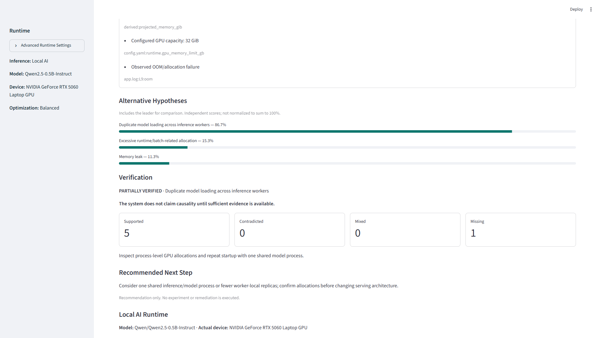
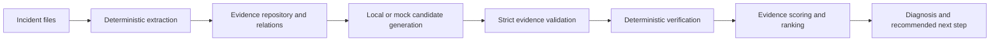

# IncidentLens

**Evidence-grounded local incident diagnosis.** Turn logs, code, configurations
and metrics into inspectable hypotheses on local hardware.

[](https://github.com/WillyTsai1006/incidentlens/actions/workflows/ci.yml)



Recorded development UI, not a current-run performance claim. RTX 5060 Laptop GPU
is validated development hardware; Intel Arc Pro B70 is an unvalidated target.

## What it does

This Phase 3 prototype compares three predefined hypotheses: duplicate model
loading, excessive runtime/batch allocation, and memory leak. It parses local
incident files, links claims to evidence, verifies hypotheses, ranks them and
recommends further investigation. It does not execute recommendations.

## Why it is different

- Accepted factual claims reference validated evidence IDs and exact normalized observations.
- Deterministic verification and scoring stay outside the LLM. **The LLM does not own final confidence.**
- Supporting, contradicting and missing evidence remain inspectable.
- Correlation and timing do not establish causality.
- Local inference has no silent mock fallback; outputs are recommendation-only.

## Architecture



Routing considers task, context, complexity, memory and latency preference, with
inspectable reasons. Profile estimates are not benchmarks; one real model has
been validated, without distributed scheduling. Run artifacts preserve inputs,
evidence, hypotheses, verification, diagnosis, routing, telemetry, prompts/raw
outputs, environment metadata and source checksums. See [architecture](docs/architecture.md).

## Demo / UI

After installation, launch:

```powershell
.venv/Scripts/python.exe -m streamlit run app/ui.py --browser.gatherUsageStats false
```

Click **Run GPU OOM Demo**, then **Analyze Incident**. In a core/UI-only installation,
select **Mock** under the collapsed **Advanced Runtime Settings** first. For real
inference, complete the local-model setup below. The UI selects CUDA when
available, otherwise explicitly selects CPU with a warning; execution failures
do not silently switch to CPU or mock inference.

The synthetic incident projects `4 × 9.5 = 38 GiB` against a nominal 32 GiB ceiling.
These are fixture values, not measurements of the development GPU or usable B70
VRAM. The inference model is separate from the incident's illustrative model.

The UI shows diagnosis, Evidence Score, supporting/contradicting/missing evidence,
alternatives, verification and Local AI Runtime. Technical details stay in
expanders. **GPU Memory Snapshot** is measured allocated memory after a call,
not peak VRAM. Unavailable metrics are N/A; mock runs are labeled.

## Controlled evaluation

**Controlled three-case evaluation. Synthetic incidents, n=3.
Not a production-accuracy benchmark.** IncidentLens ranked each intended family
first using mock and real local CUDA inference.

| Observation | Plain local LLM | IncidentLens |
| --- | --- | --- |
| Unambiguous correct top hypotheses | 0/3 | 3/3 |
| Accepted-claim traceability | 6/8 source quotations matched; free prose unverified | 100% (57/57 accepted claims) |
| Invalid citations / unsupported accepted claims | 2 invalid source quotations | 0 unsupported accepted claims |
| Deterministic verification and scoring | No | Yes |

The units in these traceability audits differ. Traceable claims and three designed
cases do not establish semantic accuracy or production RCA performance. The plain
baseline returned two ambiguous cause lists and one wrong-family answer.

See the [method and limitations](docs/controlled_evaluation.md),
[sanitized real CUDA report](docs/results/controlled_evaluation_cuda.md) and
[full public JSON](docs/results/controlled_evaluation_cuda.json).

```powershell
.venv/Scripts/python.exe -m evaluation.run_evaluation --backend mock --no-artifacts
```

Mock evaluation does not execute the real baseline. Without `--no-artifacts`,
reports go to ignored `output/controlled_evaluation/mock/`.

## Quick start

Requires Python 3.11+ and [uv](https://docs.astral.sh/uv/). Run from the repository
root. Dependency installation needs network access; mock inference needs no
weights, CUDA or model downloads. CI uses Python 3.12.

```powershell
uv --cache-dir .uv-cache venv .venv --python python
uv --cache-dir .uv-cache pip install --python .venv/Scripts/python.exe -e ".[dev,ui]"
.venv/Scripts/python.exe -m pytest -q
.venv/Scripts/python.exe -m app.main --demo
.venv/Scripts/python.exe -m app.main --demo --save-run
```

On Linux/macOS substitute `.venv/bin/python`. `--demo` preserves the Phase 2
contract; `--phase3` or `--save-run` adds routing/telemetry and timestamped `runs/`
artifacts. `--core-only` retains Phase 1 output. Use `--incident path/to/incident`
for supported local files. Source code is parsed, never executed. CLI JSON goes
to stdout, operational logging to stderr; invalid input returns exit code 2.

## Real local inference

Validated development setup: Windows, Python 3.13, **RTX 5060 Laptop GPU**, CUDA,
PyTorch 2.14.1+cu130, Transformers 4.57.6 and Hugging Face Hub 0.36.2. This GPU
validation does not cover other platforms. Install into the environment above:

```powershell
uv --cache-dir .uv-cache pip install --python .venv/Scripts/python.exe 'torch==2.14.1+cu130' --index-url https://download.pytorch.org/whl/cu130
uv --cache-dir .uv-cache pip install --python .venv/Scripts/python.exe 'transformers==4.57.6' 'huggingface-hub==0.36.2'
.venv/Scripts/hf.exe download Qwen/Qwen2.5-0.5B-Instruct --revision 7ae557604adf67be50417f59c2c2f167def9a775 --local-dir models/Qwen2.5-0.5B-Instruct --include '*.json' '*.safetensors' '*.txt' 'README.md' 'LICENSE*'
$env:HF_HUB_OFFLINE='1'
$env:TRANSFORMERS_OFFLINE='1'
.venv/Scripts/python.exe -c "import torch; assert torch.cuda.is_available(); print(torch.__version__, torch.cuda.get_device_name(0))"
.venv/Scripts/python.exe -m app.main --demo --save-run --backend transformers --profiles profiles/demo_rtx5060.json --device cuda
```

Weights are downloaded once and excluded from Git. The adapter uses
`local_files_only=True`, `trust_remote_code=False` and greedy generation. It
rejects context overflow rather than dropping evidence. Unknown evidence IDs,
extra factual prose and model scores are rejected. Invalid candidates receive
bounded retries; failed runs remain failed, without mock fallback.

For **CPU**, install `torch==2.14.1+cpu` from
`https://download.pytorch.org/whl/cpu` instead of the CUDA wheel, retain the same
Transformers/Hub versions and model revision, and run:

```powershell
.venv/Scripts/python.exe -m app.main --demo --save-run --backend transformers --profiles profiles/demo_local.json --device cpu
```

Phase 3 uses per-candidate evidence selection across three catalog families.
The unchanged legacy Phase 2 local bundle schema was unreliable with this small
model; use the Phase 3 command for the validated real demo. B70/XPU remains a
disabled target profile and has not been validated. See the
[Qwen model card](https://huggingface.co/Qwen/Qwen2.5-0.5B-Instruct).

## Validation

**220 tests collected. 218 default tests pass without model weights;
2 optional offline-model tests were separately executed and passed.**
Fresh Python 3.12 core/dev/UI installation and mock evaluation were also checked.

The [CI workflow](.github/workflows/ci.yml) runs default tests and deterministic
mock evaluation without model dependencies, weights or CUDA. Workflow validation
is currently static/local; its first hosted GitHub execution remains pending.
Optional tests require an existing local model:

```powershell
$env:INCIDENT_MODEL_PATH=(Resolve-Path 'models/Qwen2.5-0.5B-Instruct').Path
.venv/Scripts/python.exe -m pytest -q -m real_model
```

Real CUDA execution has been validated on an RTX 5060 Laptop GPU. Runtime varies
with cold loading and machine state; detailed measurements are documented
separately. The screenshot is a recorded run, not a latency guarantee.

## Limitations

Three synthetic, designed cases exercise predefined hypothesis families. This
is a targeted prototype, not arbitrary root-cause discovery or a production RCA
system. Scores are evidence heuristics, not probabilities. Verification can
strengthen or weaken hypotheses while missing observations remain explicit.
Correlation alone does not prove causality. Physical projector presentation and
Intel Arc Pro B70 execution remain unvalidated. There is no automatic remediation,
autonomous shell execution, Ray, Kubernetes or multi-node inference.
See [limitations](docs/limitations.md).

## Documentation

- [Architecture](docs/architecture.md) and [demo scenario](docs/demo_scenario.md)
- [Controlled evaluation](docs/controlled_evaluation.md) and [public CUDA results](docs/results/controlled_evaluation_cuda.md)
- [Phase 1](docs/phase1_status.md), [Phase 2](docs/phase2_status.md), [Phase 3](docs/phase3_status.md)
- [RTX validation and historical measurements](docs/rtx5060_validation.md)
- [UI validation](docs/ui_polish_status.md) and [final demo polish / latency investigation](docs/final_demo_polish.md)
- [Historical development audit](docs/development/release_readiness_2026-10-10.md)
- [Original implementation specification](docs/development/CODEX_SPEC_Incident_Diagnosis_Agent_v0.1.md)
- [MIT License](LICENSE) and [third-party components](THIRD_PARTY.md)
